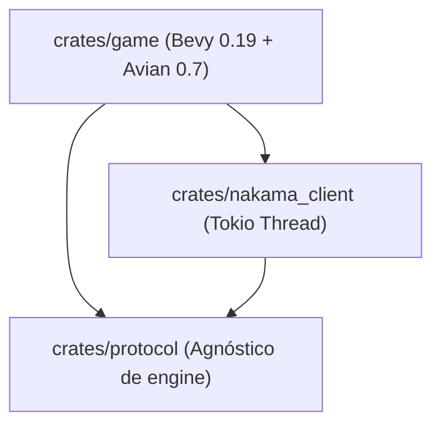

# Visão Geral da Arquitetura do Cliente

O cliente do **new_game** é estruturado como um Cargo Workspace com responsabilidades estritamente delimitadas:

1. **`protocol`**: Tipos serializáveis de mensagens e decodificação de opcodes. Não possui dependências do Bevy ou de rede.
2. **`nakama_client`**: Gerencia a thread de rede assíncrona, clientes REST de autenticação e loop WebSocket de match.
3. **`game`**: Motor gráfico Bevy, renderização de salas e avatares, interpolação de caminho e captura de clique/toque de tela.
